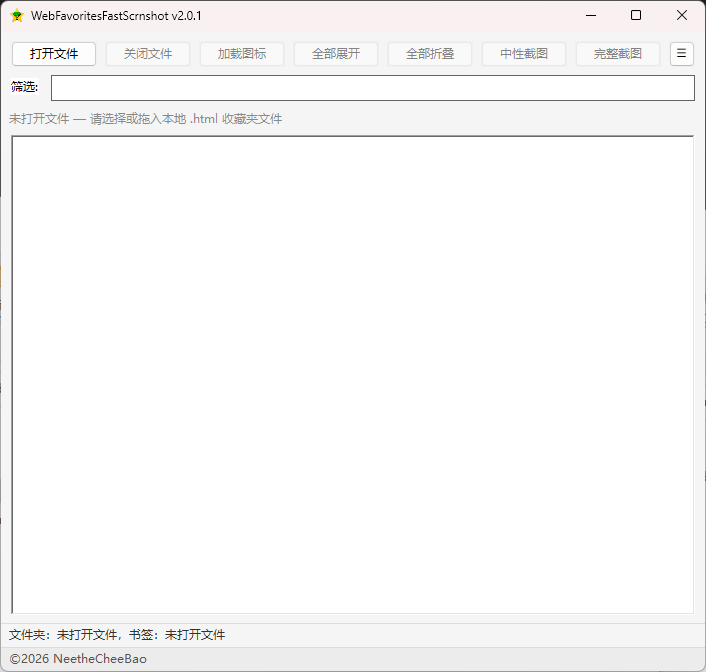
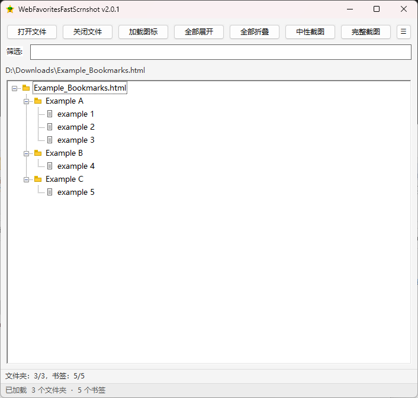

<div align="center">

<h1>Web Favorites Fast Scrnshot</h1>

[](#)
[](#)
[](#)
[](LICENSE)

本地 **网页收藏夹 HTML** 树形查看器 + **快速长图截图** 小工具（Netscape Bookmark 格式）

</div>

## 📸 工具截图

| 主程序 | 演示 |
| :---: | :---: |
|  |  |

## ✨ 特色功能

| 功能 | 说明 |
| --- | --- |
| 树形预览 | 文件夹可展开/折叠，层级清晰 |
| 筛选 | 按标题或 URL 子串过滤，并展开匹配路径 |
| 完整截图 | 按当前展开状态绘制长图 |
| 中性截图 | 对超长标题做截断绘制长图 |
| 信息栏统计 | 显示当前可见 / 文件总数（文件夹不含根行） |

## 💻 收藏夹模板兼容
- Edge
- Chrome

## ⬇️ 下载使用

[](https://github.com/NeetheCheeBao/WebFavoritesFastScrnshot/releases)

## 🛠️ 本地编译

1. 克隆仓库到本地

```bash
git clone https://github.com/NeetheCheeBao/WebFavoritesFastScrnshot.git
```

或者

```bash
gh repo clone NeetheCheeBao/WebFavoritesFastScrnshot
```

2. 一键编译

```bat
.\build.bat
```

- 产物位置：`dist\WebFavoritesFastScrnshot.exe`

### 编译环境要求

| 项 | 说明 |
| --- | --- |
| Rust | **1.79 及以上**（`rust-version` 已在 `Cargo.toml` 声明） |
| 链接器 | MSVC 工具链（VS Build Tools + Windows SDK），rustup 在 Windows 上默认会引导安装 |
| 依赖库 | **无需手动安装**，`cargo` 会根据 `Cargo.toml` / `Cargo.lock` 自动拉取并编译 |

## 📁 项目结构

```text
WebFavoritesFastScrnshot
|   .gitignore
|   build.bat                     # 一键编译脚本
|   build.rs                      # 图标资源
|   Cargo.lock                    # 依赖版本锁定
|   Cargo.toml                    # 依赖声明与 release 配置
|   LICENSE
|   README.md
|   version.ini                   # 程序名与版本号
|
+---assets
|       icon.ico                  # 图标
|
+---lang
|       index.ini                 # 语言包索引
|       zh_cn.ini                 # 简体中文文案
|
+---screenshot
|       demo1.png
|       demo2.png
|
\---src
    |   main.rs                   # 入口：DPI、主题、消息循环
    |
    +---app
    |       commands.rs           # 打开/关闭/筛选/展开折叠/截图
    |       menu.rs               # 树交互与右键菜单
    |       mod.rs                # App 状态、事件分发、自绘栏刷新
    |       tree_build.rs         # 建树、可见行收集、行宽估算
    |
    +---config
    |       ini.rs                # 通用 INI 解析
    |       mod.rs                # 读取 version.ini 与资源路径
    |
    +---i18n
    |       mod.rs                # 语言包加载与文案查表
    |
    +---model
    |       mod.rs                # 书签树数据模型（Arena）
    |
    +---parser
    |       entities.rs           # HTML 实体解码
    |       mod.rs                # Netscape 收藏夹解析
    |
    +---platform
    |       dialogs.rs            # 打开/保存文件对话框
    |       dpi.rs                # DPI 感知与像素换算
    |       encoding.rs           # 编码探测（UTF-8/GBK/GB18030）
    |       mod.rs                # 模块导出
    |       paths.rs              # 已知文件夹（下载目录）
    |       shell.rs              # 打开链接/剪贴板/消息框/定位文件
    |       theme.rs              # 启用 comctl32 v6 视觉样式
    |
    +---screenshot
    |       gdi.rs                # GDI 离屏画布与字体
    |       mod.rs                # 长图布局与绘制
    |       png.rs                # PNG 编码器
    |
    \---ui
            bars.rs               # 路径行/信息栏/状态栏自绘
            context_menu.rs       # 右键弹出菜单
            icons.rs              # 三个共享图标（星/夹/页）
            layout.rs             # 窗口与控件布局
            mod.rs                # 模块导出
            tree_view.rs          # 树辅助：滚动条/行高/命中测试
```

## ⚖️ 许可证

本项目采用 MIT 许可证 - 详情请参阅 [LICENSE](LICENSE) 文件。
